# ⚡ Awesome Local LLM Runtimes

> 🚀 **A curated directory of high-performance inference engines, local API servers, on-device execution runtimes, and self-hosted open-weights LLM platforms.**

  
  
  
  
  
  
  

**Explore best-in-class runtimes for offline LLMs, private on-premise AI, edge computing, and zero-cloud-fee inference.**

---

## 📑 Table of Contents

- [🔍 Sector Overview & Market Dynamics](#-sector-overview--market-dynamics)
- [☁️ SaaS & Hosted Platforms](#️-saas--hosted-platforms)
- [💻 Open-Source GitHub Projects](#-open-source-github-projects)
- [🎯 Choosing the Right Runtime](#-choosing-the-right-runtime)
- [🤝 How to Contribute](#-how-to-contribute)
- [💖 Support & Sponsor](#-support--sponsor)
- [📈 Star History](#-star-history)
- [⚠️ Disclaimer](#️-disclaimer)

---

## 🔍 Sector Overview & Market Dynamics

The global **AI inference and runtime market** has reached an estimated valuation between **$100 billion and $130+ billion**, expanding at a rapid compound annual growth rate as enterprises transition from raw model training to cost-sensitive, real-time token generation and agentic deployment.

Market dynamics reflect a **moderately fragmented ecosystem** currently undergoing selective concentration. While centralized foundational model serving exhibits strong platform network effects, on-device and edge runtime execution remains open and varied across specialized hardware backends (Apple Silicon Metal, NVIDIA TensorRT, AMD ROCm, Vulkan, and edge NPUs). Standardized C/C++ inference cores (`llama.cpp`) and high-throughput batching engines (`vLLM`) anchor the foundation layer, while specialized desktop applications, multi-modal servers, and managed hybrid clouds compete fiercely for developer mindshare.

---

## ☁️ SaaS & Hosted Platforms

Managed inference platforms and hybrid local-to-cloud SaaS runtimes simplify deployment, eliminate local hardware constraints for 70B+ parameter models, and provide unified developer tooling with enterprise guarantees.

| 🏢 Platform | 💰 Pricing (Starting Tier) | 🎁 Free Tier / Trial Limit | 📊 Company Size / Valuation | 🛠️ Primary Focus & Features |
| :--- | :--- | :--- | :--- | :--- |
| **[Baseten](https://www.baseten.co/)** | Pay-as-you-go GPU instance billing starting at **$0.000185/sec** (~$0.67/hr for T4 GPU) | **$30 free starter credits** on workspace signup to test dedicated deployments & Model APIs | **$13.0B valuation** ($1.5B Series F) | Production serverless model serving with zero-cold-start autoscaling, dedicated instances, and managed open model APIs. |
| **[Together AI](https://www.together.ai/)** | Pay-as-you-go serverless inference starting at **$0.18 / 1M tokens** (minimum upfront credit purchase: **$15**) | **No free tier** ($15 minimum initial credit purchase required; up to $50K via Startup Accelerator) | **$8.3B valuation** ($800M Series C) | Ultra-fast cloud inference engine, batch processing, dedicated GPU clusters, and fine-tuning for open-weights models. |
| **[Anyscale](https://www.anyscale.com/)** | Pay-as-you-go Ray compute clusters starting at **$0.55/hr** (standard compute) or per-token endpoints | **$100 free starting credits** for new user signups to test endpoints & distributed workloads | **$1.65B valuation** (Acquired by Nscale; previously $1.4B) | Distributed Ray computing runtime and OpenAI-compatible serverless endpoints for open-source foundation models. |
| **[Ollama Cloud](https://ollama.com/)** | **$20.00 / month** (Pro Plan: includes $60 monthly cloud inference credits; Max Plan at $100/mo) | **$0 / month Free Plan** (Includes basic starter credits for starter models; 1 concurrent cloud request; 100% free offline CLI) | **$260M valuation** ($88M total raised; $65M Series B) | Cloud-hosted companion for the Ollama runtime; handles massive frontier models that exceed local workstation VRAM. |
| **[LM Studio](https://lmstudio.ai/)** | **$20.00 / month** (Bionic+ Plan; Pro Plan available at $100/mo; Custom Enterprise tiers) | **$0 / month Free Forever Plan** (Unlimited local execution via llama.cpp/MLX, offline voice transcription, LM Link for 5 devices, limited web search) | **$19.3M funding** (~$1.8M ARR estimated) | Polished desktop GUI and headless local API daemon with optional US-hosted Zero Data Retention (ZDR) agentic cloud models. |

---

## 💻 Open-Source GitHub Projects

Explore the leading self-hosted engines, desktop applications, and distributed local inference stacks, ranked by community adoption and GitHub_Stars.

| 📦 Repository & Project | ⭐ GitHub_Stars | ⚙️ Core Architecture / Backend | 🎯 Key Strengths & Use Cases |
| :--- | :--- | :--- | :--- |
| **[Ollama](https://github.com/ollama/ollama)** |  | Go + `llama.cpp` wrapper | **The one-command developer standard.** Simple CLI (`ollama run llama3.3`), Modelfiles, native REST API on `localhost:11434`, multimodal vision, and broad IDE integrations (Open WebUI, Continue, Cline). |
| **[llama.cpp](https://github.com/ggml-org/llama.cpp)** |  | Pure C/C++ (GGML / GGUF) | **The foundational local inference engine.** 1.5-bit to 8-bit quantization, Apple Metal / Accelerate, AVX-512, CUDA, ROCm, Vulkan, and hybrid CPU+GPU RAM offloading for zero-dependency portability. |
| **[vLLM](https://github.com/vllm-project/vllm)** |  | Python / C++ (PagedAttention) | **The production high-throughput serving standard.** Continuous batching, PagedAttention KV-cache management, PyTorch Foundation project, delivering 14x–24x throughput for multi-user clusters. |
| **[GPT4All](https://github.com/nomic-ai/gpt4all)** |  | C++ / Qt / LocalDocs | **Privacy-centric desktop chat with LocalDocs.** Integrated local vector database for private file RAG on consumer hardware without telemetry or external network calls. |
| **[LLaMA-Factory](https://github.com/hiyouga/LLaMA-Factory)** |  | PyTorch / Transformers / PEFT | **Unified fine-tuning and local inference suite.** Visual WebUI supporting 100+ LLMs/VLMs with LoRA, QLoRA, full parameter tuning, and direct local evaluation. |
| **[LocalAI](https://github.com/mudler/LocalAI)** |  | Go + Multi-backend C++ | **All-in-one OpenAI-compatible local AI stack.** Manages LLMs, Stable Diffusion image generation, Whisper audio transcription, TTS, and rerankers in a single Dockerized container. |
| **[Exo](https://github.com/exo-explore/exo)** |  | Python / P2P Dynamic Clustering | **Distributed cluster inference on consumer devices.** Pools spare hardware (M-series Macs, Linux boxes, iPhones) into an interconnected cluster to run 70B+ parameter models. |
| **[Text Generation WebUI](https://github.com/oobabooga/text-generation-webui)** |  | Gradio / Multi-loader WebUI | **The power-user's versatile backend.** Switchable loaders for llama.cpp, ExLlamaV2, Transformers, AutoAWQ, and AutoGPTQ with OpenAI-compatible API endpoints and extensions. |
| **[Jan](https://github.com/janhq/jan)** |  | Electron / TypeScript / C++ | **Open-source desktop alternative to LM Studio.** Privacy-first desktop interface with local model hub, `jan serve` CLI, Cortex inference engine, and unified local server endpoints. |
| **[SGLang](https://github.com/sgl-project/sglang)** |  | Python / C++ / CUDA (RadixAttention)| **Fast execution engine for complex LLM workflows.** RadixAttention for automatic KV cache reuse across multi-turn chats, few-shot prompting, and structured JSON generation. |
| **[llamafile](https://github.com/Mozilla-Ocho/llamafile)** |  | Cosmopolitan Libc / C++ | **Multi-OS single-file executable LLMs.** Mozilla project packaging model weights and runtime into a single self-contained polyglot binary that executes on 6 OS architectures. |
| **[TensorRT-LLM](https://github.com/NVIDIA/TensorRT-LLM)** |  | C++ / CUDA / TensorRT | **NVIDIA's enterprise GPU optimization library.** Maximum inference throughput on GeForce RTX, workstation Ada Lovelace, and data center GPUs (H100/H200/B200) with in-flight batching. |
| **[KoboldCpp](https://github.com/LostRuins/koboldcpp)** |  | C/C++ / GGUF | **Single-file zero-install runner for creative writing.** Optimized for roleplay, storytelling, and interactive fiction with KoboldAI and OpenAI-compatible API backends. |
| **[TGI (Text Generation Inference)](https://github.com/huggingface/text-generation-inference)** |  | Rust / Python / C++ | **Hugging Face production server.** Powers HuggingChat; features tensor parallelism, FlashAttention v2, Paged Attention, token streaming, and production Prometheus telemetry. |
| **[ExLlamaV2](https://github.com/turboderp/exllamav2)** |  | C++ / CUDA / EXL2 Quantization | **Blazing-fast modern GPU inference library.** Custom EXL2 mixed-precision quantization format designed to squeeze maximum tokens-per-second out of consumer NVIDIA RTX cards. |

---

## 🎯 Choosing the Right Runtime

| 💡 Your Hardware & Setup | 🏆 Recommended Tool | 📌 Why Choose It? |
| :--- | :--- | :--- |
| **Apple Silicon (M1/M2/M3/M4)** | **[llama.cpp](https://github.com/ggml-org/llama.cpp)** / **[Ollama](https://github.com/ollama/ollama)** | Native Metal acceleration with unified memory access for massive models. |
| **Single Desktop (Windows/Mac/Linux)** | **[LM Studio](https://lmstudio.ai/)** / **[Jan](https://github.com/janhq/jan)** | Intuitive graphical interface, one-click model downloads, and built-in local server. |
| **Developer CLI & Local Agent Harness** | **[Ollama](https://github.com/ollama/ollama)** / **[SGLang](https://github.com/sgl-project/sglang)** | Standardized port `11434`, seamless tool calling, and high-performance prompt cache reuse. |
| **Production Cluster & Multi-User Server**| **[vLLM](https://github.com/vllm-project/vllm)** / **[TGI](https://github.com/huggingface/text-generation-inference)** | PagedAttention continuous batching delivers 15x+ concurrent throughput over standard wrappers. |
| **Heterogeneous Devices / Distributed Rig**| **[Exo](https://github.com/exo-explore/exo)** | Combines idle laptops, desktops, and phones into an ad-hoc inference cluster. |
| **All-in-One Multimodal Engine** | **[LocalAI](https://github.com/mudler/LocalAI)** | Drop-in OpenAI API replacement for text, embeddings, Whisper transcription, and image synthesis. |

---

## 🤝 How to Contribute

We welcome community contributions! To suggest a new local runtime, engine, or SaaS platform:

1. 🍴 **Fork the repository** to your GitHub account.
2. 🌿 **Create a new branch**: `git checkout -b add-new-runtime`.
3. 📝 **Edit `README.md`**: Follow existing table and formatting conventions:
   - For **SaaS platforms**: Include platform name, starting tier price, specific free tier/trial limits, company valuation/funding, and features.
   - For **Open-Source projects**: Include repository name, Stars_Badge with `style=social&color=white`, core architecture, and primary strengths.
4. 🚀 **Submit a Pull Request** with a concise description of why the tool should be included.

---

## 💖 Support & Sponsor

Thank you for exploring and building with the local AI ecosystem! If you find this curated list valuable for your projects, research, or development workflows, please consider supporting the project:

- ⭐ **Star this repository** to help others discover local LLM runtimes!
- 🍴 **Fork and share** with your developer network and AI teams.
- ☕ **Buy a coffee & sponsor**: Support ongoing curation and maintenance via the [GitHub Sponsors Dashboard](https://github.com/sponsors/ishandutta2007).

---

## 📈 Star History

---

## ⚠️ Disclaimer

- This repository is a **community-curated index** provided for educational and developer productivity purposes.
- **Licensing & Architecture Awareness**: While tools like Ollama, llama.cpp, vLLM, and LocalAI are fully open-source, desktop tools like LM Studio operate on proprietary closed-source foundations. Always verify individual project licenses before production and commercial distribution.
- **Privacy Considerations**: Local runtimes prevent inference prompts from reaching third-party cloud servers. However, model weight downloads, automated update checks, and remote tool integrations communicate over the network. Always audit outbound connections in air-gapped environments.

---

Maintained with ❤️ by <a href="https://github.com/ishandutta2007">Ishan Dutta</a> and the open-source AI community.

